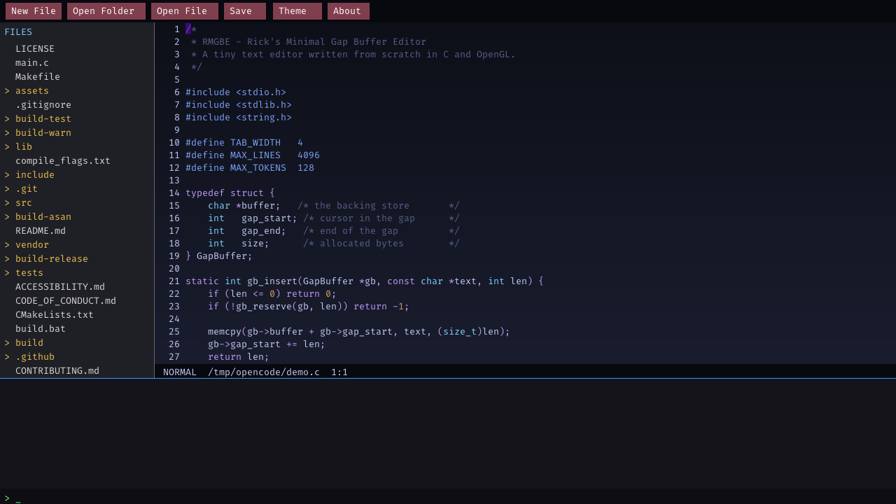

# RMGBE

Rick's Minimal Gap Buffer Editor - a lightweight text editor built from scratch in C and OpenGL.



Features syntax highlighting for C/C++, a built-in terminal, file browser sidebar, smooth cursor movement, and vim-style keybindings (H/J/K/L). Runs on Windows, macOS, and Linux.

## Building

CMake 3.15+ is the single source of truth for all build settings. The platform scripts below only select a configuration and invoke CMake.

**Windows:**
Requires [MinGW](https://www.mingw-w64.org/) with GCC and [CMake](https://cmake.org/). GLFW is included in `lib/`.
```bat
build.bat debug      REM with debug symbols
build.bat release    REM optimized
```
Output: `build\bin\RMGBE.exe`

**Linux / macOS:**
Requires [CMake](https://cmake.org/) 3.15+ and [GLFW](https://www.glfw.org/).
```sh
# Linux
sudo apt install libglfw3-dev cmake

# macOS
brew install glfw cmake

# Build
make debug           # output: build-debug/bin/RMGBE
make release         # output: build-release/bin/RMGBE
make                 # output: build/bin/RMGBE
```

You can also invoke CMake directly:
```sh
cmake -S . -B build -DCMAKE_BUILD_TYPE=Release
cmake --build build --parallel
```

Run `RMGBE path/to/file` to open a file on startup.

## Controls

| Key | Action |
|-----|--------|
| `i` / `a` | Enter insert mode at the cursor / after the cursor |
| `Escape` | Return to normal mode |
| `h` `j` `k` `l` | Move cursor left / down / up / right |
| Arrow keys | Move cursor in normal and insert mode |
| `0` / `Home` | Jump to start of line |
| `^` (Shift+6) | Jump to first non-blank character |
| `$` (Shift+4) / `End` | Jump to end of line |
| `u` / `Ctrl+Z` | Undo |
| `Ctrl+R` / `Ctrl+Y` | Redo |
| `Ctrl+S` | Save (uses Save As for untitled files) |
| `Ctrl+F` | Open search bar |
| `Enter` / `F3` | Find next match |
| `Shift+F3` | Find previous match |
| `Ctrl+C` / `Ctrl+V` | Copy / paste |
| `v` | Enter visual mode |
| `y` | Visual mode: yank selection |
| `d` / `x` | Visual mode: delete selection |
| `x` | Normal mode: delete character under cursor |
| `p` | Paste (normal and visual mode) |
| `o` | Open a line below and enter insert mode |
| `Tab` | Insert a tab character (insert mode) |
| `Ctrl+N` | New file |
| `Ctrl+Tab` | Switch focus between editor and terminal |

Scroll wheel scrolls the editor. Click files in the sidebar to open them, drag to select text, and click the terminal to run shell commands.

### Custom shortcuts

RMGBE borrows Vim's modal editing and `h/j/k/l` movement, but it is not a full Vim implementation. These shortcuts are specific to RMGBE:

- `Ctrl+S` saves, `Ctrl+F` searches, and `Ctrl+N` starts a new file instead of Vim's command mode.
- `Ctrl+A` jumps to the start of the line rather than selecting all text.
- `Ctrl+Z` / `Ctrl+R` (and `Ctrl+Y`) are available as conventional undo/redo aliases in addition to `u`.
- `Ctrl+Tab` moves focus to the built-in terminal; arrow keys work in both normal and insert mode.
- There is no command mode, register system, macro recording, or `.vimrc` support.

## Theme Editor

Click **Theme** in the toolbar to open the theme editor. You can customize:

- **Editor colors**: background, text, cursor, toolbar, buttons, status bar
- **Syntax colors**: keywords, types, strings, numbers, comments, preprocessor directives, operators
- **File panel colors**: background, selection, text, folder text
- **Terminal colors**: background, border, output text, input background
- **Modal colors**: about/theme-editor panel background and border
- **Search colors**: search bar background, match highlight, current match highlight
- **Background gradient**: choose vertical, horizontal, or no gradient
- **Font size**: adjust the editor font size (6–72pt, live preview)
- **Font file**: load a custom `.ttf` font or use the built-in embedded font

### How it works

1. Click any color in the scrollable list to select it
2. Type a hex value (`#FF5500`) or RGB values (`255,85,0`) in the input field
3. Press Enter to apply the change live

### Theme files (.rmgtheme)

Themes can be saved and shared as `.rmgtheme` files - simple text files with hex color values:

```
name = My Theme
background_gradient = vertical
font_size = 16.0
background = #0d1117
background_end = #161b22
text = #e6edf3
toolbar = #010409
button = #8957e5
cursor = #1f6feb
statusbar = #010409
syntax_default = #e6edf3
keyword = #ff7b72
type = #ffa657
string = #a5d6ff
number = #79c0ff
comment = #8b949e
preprocessor = #d2a8ff
operator = #ff7b72
fp_background = #1f1f26
fp_selection = #336699
fp_text = #d9d9d9
fp_folder = #e6bf4d
term_background = #14141a
term_border = #3399ff
term_text = #cce6cc
term_input_bg = #0d0d12
modal_background = #1e1e1e
modal_border = #666673
search_bar_bg = #26262e
search_match = #ffbf00
search_match_cur = #ffd900
```

Use **Load...** to import a theme file and **Save As...** to export your current theme. Use **Reset** to restore the default colors.

## Design

RMGBE stays small by using a few deliberately simple data structures:

- **Gap buffer.** The document is stored as one byte buffer split by a movable gap. Insertions and deletions at the cursor are cheap; the gap grows geometrically to keep amortized insertion cost linear.
- **Line index.** A cached array of line start offsets is rebuilt only when the buffer changes, so row/column lookups do not rescan the whole document on every keystroke.
- **Syntax cache.** Highlighting is tokenized once per line and stored with the parser state entering and leaving that line. A redraw reuses cached tokens and only re-tokenizes from the first changed line.
- **Delta undo.** Undo and redo store only the inserted or deleted bytes plus position and cursor state. The undo stack is capped at 8 MiB total (1 MiB per entry); older entries are discarded instead of consuming unbounded memory.
- **Safe saves.** Files are written to a temporary file in the same directory, flushed, and atomically renamed over the original, so an interrupted save cannot truncate the document.
- **Encoding and line endings.** Input is decoded as UTF-8 for display and cursor movement. CRLF files are normalized to LF in memory and written back as CRLF. Tabs are expanded to four-column stops for display and highlighting.

## Known Limitations

- The editor refuses to load files larger than 256 MiB, and the line index is capped at 4096 lines. Longer files are not fully navigable.
- The embedded glyph atlas covers Latin-1. Other Unicode characters are preserved in the file but are displayed as `?`.
- Tab width is fixed at 4 columns. Tabs are stored as tab characters and only expanded for display, so editing inside a tab stop can feel coarse.
- CRLF is tracked per file but mixed line endings are normalized: a file containing both CRLF and LF is saved uniformly with the detected style.
- There is a single editor view per window, with no split panes, text wrapping, plugins, or language server support.
- Syntax highlighting covers C and C++ only.

## License

RMGBE is source-available under the [PolyForm Noncommercial License 1.0.0](https://polyformproject.org/licenses/noncommercial/1.0.0). You may use, study, modify, and share it for noncommercial purposes; commercial use is not permitted. See [LICENSE](LICENSE) for the full terms.

Required Notice: Copyright (c) 2026 urboirad (https://github.com/urboirad/RMGBE)
